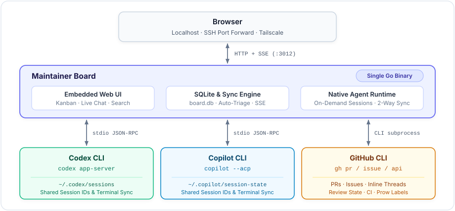

<div align="center">

# Maintainer Board

A local Kanban board for managing GitHub PR reviews, issue threads, and parallel **Codex CLI** / **GitHub Copilot CLI** sessions in one browser tab.


<br/>


</div>

---

## Quick Start

Requires Go 1.26+ (or a prebuilt binary from [Releases](https://github.com/JesseStutler/maintainer-board/releases)), `gh` CLI (authenticated), and `codex` and/or `copilot` CLI on `PATH`.

```bash
git clone https://github.com/JesseStutler/maintainer-board.git
cd maintainer-board
MB_WORKSPACE=/path/to/your/repo MB_REPO=your-org/your-repo ./run.sh
```

Open `http://127.0.0.1:3012`.

If your repos and agents live on a remote dev machine, forward port `3012`:

```bash
ssh -N -L 3012:127.0.0.1:3012 user@your-dev-machine
```

---

## Features

### 1. Automatic GitHub Sync, Card Signals & Auto-Move

Maintainer Board polls linked PRs and Issues in the background via `gh` (default every 2 minutes) and keeps each card updated automatically:

- **What each card shows:** PR/Issue status (`OPEN` / `MERGED` / `CLOSED`), multi-link count (`+1` when a card tracks multiple PRs and Issues), author and `MINE` tag, CI status, your personal review state (`Not reviewed`, `You: Replied`, `Re-review needed`, `Approved`), commit/comment counts, live agent status, and a click-to-copy native Session ID.
- **Actionable update banners:** Filters out bot comments and your own activity, surfacing only real changes on the card (for example, `Author pushed +2 commits, Author replied (+1)` on PRs you review, or `Reviewer commented (+2), Changes requested` on your own PRs).
- **Automatic column transitions:** Cards with new updates move to `Updates`; submitting a review (including Prow `/lgtm` + `/approve`) or replying to an issue moves them to `Waiting` (or `Ready` when approved with passing CI); merged or closed items move to `Done`.

### 2. Search & Filtering

Find cards quickly as the board grows:

- **Multi-way search:** Filter by **PR/Issue author** (including `Mine`), **category**, **agent** (`Copilot` / `Codex`), **native Session ID**, **card metadata**, or **full conversation text**.
- **AI Search:** Run natural-language semantic search across cards and chat transcripts when you only remember what a session was about.
- **Focus controls:** Toggle `Updates Only`, pin priority cards to the top, or collapse / compact individual columns.

### 3. Native Codex & Copilot Chat Workspace

Click any card (or press `F` to expand) to work directly with the underlying CLI inside your local repository:

- Talks straight to `codex app-server` and `copilot --acp` with no wrapper prompts, so agents can run tests, builds, and local scripts with live expandable command output in the chat.
- Shares the same native Session IDs and disk history as your terminal (`codex resume <id>` / `copilot --resume <id>`), keeping terminal and web turns in sync.
- Switch model, reasoning effort, and tool approval mode (`Default`, `Auto`, `YOLO`) directly from the composer, or generate concise task summaries with **AI Summary** and **AI Title**.


### 4. Local Session History Import

Scan existing local `~/.codex` and `~/.copilot` sessions and bring forgotten terminal work onto the board, with instant filtering by Session ID, folder, branch, conversation text, or AI semantic search.


---

## Architecture

<p align="center">
  
</p>

Everything runs in a single Go binary with an embedded web UI and a local SQLite database (`board.db`). Agent subprocesses start on demand when you resume or send a message; idle cards hold no background agent process.

> Optional legacy mode: pass `--runtime ao --ao-url http://127.0.0.1:3001` if you want to delegate sessions to an existing [Agent Orchestrator (`ao`)](https://github.com/ComposioHQ/agent-orchestrator) daemon.

---

## Configuration

Common flags (also editable in the UI **Settings** dialog):

```bash
./maintainer-board \
  --workspace /path/to/your/repo \
  --default-repo your-org/your-repo \
  --approval-mode bypass-permissions \
  --addr 127.0.0.1:3012
```

> **Security:** Maintainer Board controls live local agent sessions and has no login layer. Bind to `127.0.0.1` with SSH port forwarding, or use Tailscale with `--allowed-hosts`.

<details>
<summary>All CLI flags, environment variables, and development commands</summary>

### CLI Flags

| Flag | Default | Description |
| --- | --- | --- |
| `--addr` | `127.0.0.1:3012` | HTTP listen address. |
| `--db` | `./data/board.db` | SQLite database path. |
| `--runtime` | `native` | Agent runtime: `native` (default) or `ao` (legacy). |
| `--workspace` | *(current directory)* | Comma-separated local workspace paths. |
| `--default-repo` | `volcano-sh/volcano` | Default `owner/repo` for shorthand `#123` links. |
| `--sync-interval` | `120s` | GitHub background sync interval (min `10s`). |
| `--ao-sync-interval` | `5s` | Session sync interval (min `1s`). |
| `--gh-user` | *(auto from `gh`)* | GitHub login used to detect authored PRs and personal reviews. |
| `--approval-mode` | *(agent default)* | `default`, `accept-edits`, `auto`, or `bypass-permissions` (YOLO). |
| `--summary-model` | `gemini-3.8-flash` | Model for AI Summary, AI Title, and AI Search. |
| `--summary-effort` | `low` | Reasoning effort for AI helpers. |
| `--ci-ignore-contexts` | `tide` | Comma-separated CI contexts ignored in rollup. |
| `--prow-approval-labels` | `true` | Treat `lgtm` + `approved` labels as approved. |
| `--allowed-hosts` | `""` | Extra allowed `Host` headers (for Tailscale/LAN). |
| `--gh-path` / `--codex-path` / `--copilot-path` | `gh` / `codex` / `copilot` | Custom CLI binary paths. |
| `--history-home` | `$HOME` | Home directory containing `.codex` and `.copilot`. |
| `--ao-url` / `--ao-project` | `http://127.0.0.1:3001` | Optional AO daemon settings (`--runtime ao`). |
| `--log-level` | `info` | `debug`, `info`, `warn`, or `error`. |

`./run.sh` environment overrides: `MB_ADDR`, `MB_DB`, `MB_RUNTIME`, `MB_WORKSPACE`, `MB_REPO`, `MB_SYNC_INTERVAL`, `MB_AO_URL`.

### Development & Tests

```bash
go vet ./...
go test -race -count=1 ./...
node --test web/tests/*.test.mjs
```

</details>

## License

[MIT](LICENSE)
