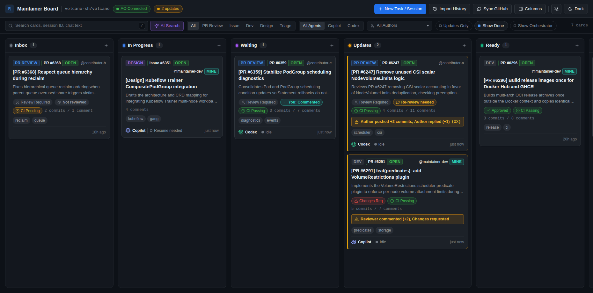
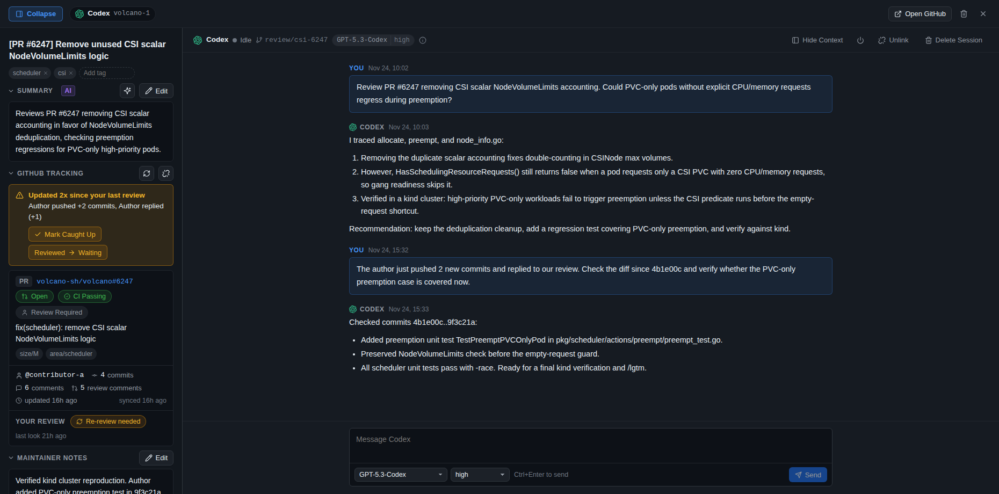
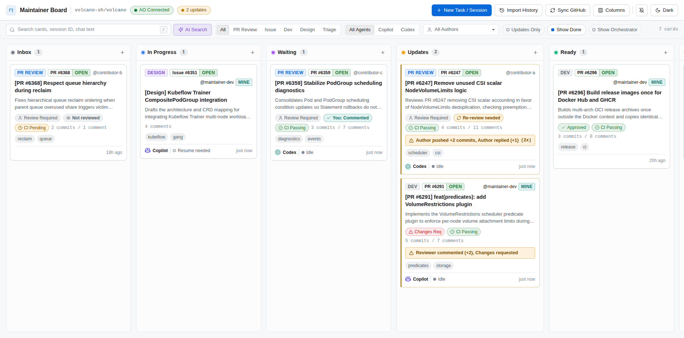

# Maintainer Board

A lightweight, single-binary Kanban workspace for open-source maintainers who juggle dozens of GitHub PR reviews, issue threads, and parallel AI coding sessions (**GitHub Copilot CLI** and **OpenAI Codex**) across repositories and machines.

Maintainer Board runs standalone with **zero extra daemons**: it talks directly to native **`codex app-server`**, **`copilot --acp`**, and the **`gh`** CLI, giving you full native agent capabilities (including local builds, tests, and two-way terminal/web session sync) inside a single browser workspace.


---

## Architecture

```
Browser (Laptop / Desktop / Remote via SSH or Tailscale)
        |
        v
Maintainer Board (Single Go Binary + SQLite + Embedded Web UI, :3012)
   |                              |                        |
   v                              v                        v
codex app-server /            gh CLI                Local Session Stores
copilot --acp (stdio RPC)     (PR / Issue / CI)     (~/.codex & ~/.copilot)
```

- **100% Native Agent Runtime (default)**: Spawns and resumes `codex app-server` and `copilot --acp` directly in your workspace with no wrapper system prompts or forced worktrees. Sessions created in the board share the exact same native Session IDs and local history files as your terminal, with automatic two-way sync.
- **Optional legacy `ao` mode**: If you prefer running sessions behind an upstream [Agent Orchestrator (`ao`)](https://github.com/ComposioHQ/agent-orchestrator) daemon for worktree isolation, pass `--runtime ao --ao-url http://127.0.0.1:3001`.

---

## Showcase

### 1. Maintainer Kanban with Role-Aware GitHub Tracking



- **Role-aware PR & Issue tracking**: Automatically distinguishes PRs you review (`PR REVIEW`), PRs you author (`MINE`), and Issue threads you participate in:
  - **Reviewing others' PRs**: Surfaces actionable updates (`Author pushed +N commits`, `Author force-pushed`, `Author replied (+N)`, `Re-review needed`) while filtering out your own comments and bot noise.
  - **Tracking your own PRs (`MINE`)**: Ignores your own pushes/comments and highlights reviewer comments, `Changes requested`, or `Approved`.
  - **Issue reply tracking & multi-link cards**: Link multiple PRs and Issues to a single card (e.g. `#6081 #6196`) and track follow-up replies on issues alongside PR reviews.
  - **Inline review threads & Prow support**: Polls both issue comments and inline review threads, and recognizes Prow `/lgtm` + `/approve` labels alongside GitHub review states.
- **Automatic column transitions**: Unread updates move cards to **Updates**; submitting a fresh review clears unread alerts and moves cards to **Waiting** (or **Ready** once approved with green CI); merged/closed items move to **Done**.
- **Flexible board ergonomics**: Filter by category, agent, PR author, or `Updates Only`; customize, reorder, collapse, or per-column compact columns; pin priority cards to the top.

### 2. Native Copilot & Codex Workspace with Live Command Output



- **Full-width or side-drawer chat**: Inspect metadata in the resizable side drawer, or press `F` (**Expand**) for a full-width workspace with a collapsible context rail.
- **Full native capabilities + live terminal output**: Run tests, builds, and scripts directly through native `codex` / `copilot` with expandable live command output blocks in the conversation stream.
- **Two-way terminal sync & copyable Session IDs**: Every card and drawer exposes a one-click copyable native Session ID (`codex resume <id>` / `copilot --resume <id>`). Turns run in a local terminal automatically appear in the board and vice versa.
- **Smooth chat controls**: Switch agent, model, reasoning effort, and approval mode (`default`, `accept-edits`, `auto`, `bypass-permissions`) per session; `Enter` sends, `Ctrl+Enter` inserts a newline, and clicking **Stop** restores your prompt to the composer for quick editing.
- **Fast AI helpers**: One-click **Summarize with AI** and **AI Title** rewrite verbose transcripts into concise task summaries.

### 3. Import Local Terminal Sessions & Semantic Search


- **Recover any terminal session**: Scans your local `~/.copilot/session-store.db` and `~/.codex/sessions/**/*.jsonl` directly to import existing sessions into the board.
- **Find by anything you remember**: Filter instantly by native Session ID, title, directory, git branch, or words inside the conversation -- or run **AI Search** for semantic recall.

### 4. Dark & Light Themes, Single Binary



- Single static Go binary with all HTML/CSS/JS/SVG assets embedded via `go:embed`.
- Local SQLite (WAL mode) database with automatic schema migrations.
- Keyboard shortcuts (`/` search, `N` new task, `F` expand/collapse workspace, `Esc` close).

---

## Prerequisites

1. **Go 1.24+** (to build from source).
2. **GitHub CLI (`gh`)** authenticated via `gh auth login` (for PR/Issue sync).
3. **Codex CLI (`codex`)** and/or **Copilot CLI (`copilot`)** on `PATH` (for live agent sessions, AI summaries, and AI search).

---

## Quick Start

```bash
git clone https://github.com/JesseStutler/maintainer-board.git
cd maintainer-board

# Build and start with ./run.sh (auto-rebuilds when Go/web sources change)
MB_WORKSPACE=/path/to/your/repo MB_REPO=your-org/your-repo ./run.sh
```

Or build and run the binary directly:

```bash
go build -o ./maintainer-board ./cmd/maintainer-board

./maintainer-board \
  --addr 127.0.0.1:3012 \
  --db ./data/board.db \
  --workspace /path/to/your/repo \
  --default-repo your-org/your-repo
```

Open `http://127.0.0.1:3012` in your browser.

---

## Remote & Multi-Device Access

Keep your agents and repositories on one workstation/server and access the full board from any laptop over a single port (`127.0.0.1:3012` by default):

### Option A: SSH Local Port Forwarding (Recommended)

```bash
ssh -N -L 3012:127.0.0.1:3012 user@your-dev-machine
```

Then open `http://127.0.0.1:3012` locally. No ports are exposed on the network and loopback host checks pass automatically.

### Option B: Tailscale / LAN Binding

Pass `--allowed-hosts` so Host-header protection permits your Tailscale IP or private hostname:

```bash
./maintainer-board \
  --addr 100.x.y.z:3012 \
  --allowed-hosts "100.x.y.z:3012,devbox.tailnet.ts.net:3012" \
  --workspace /path/to/your/repo \
  --default-repo your-org/your-repo
```

> **Security note**: Maintainer Board has no built-in login layer because it controls live local agent sessions. Always keep it behind loopback + SSH forwarding, Tailscale ACLs, or an authenticated reverse proxy.

---

## CLI Flags

| Flag | Default | Description |
| --- | --- | --- |
| `--addr` | `127.0.0.1:3012` | HTTP listen address. |
| `--db` | `./data/board.db` | SQLite database path (parent directory created automatically). |
| `--runtime` | `native` | Agent runtime: `native` (direct `codex app-server` / `copilot --acp`) or `ao` (legacy AO daemon). |
| `--workspace` | *(current directory)* | Comma-separated local workspace paths available in native mode. |
| `--default-repo` | `volcano-sh/volcano` | Default `owner/repo` used for shorthand `#123` references. |
| `--sync-interval` | `120s` | Background GitHub sync interval (minimum `10s`). |
| `--ao-sync-interval` | `5s` | Background session sync interval (minimum `1s`). |
| `--gh-path` | `gh` | Path to the GitHub CLI binary. |
| `--gh-user` | *(auto from `gh api user`)* | GitHub login used to identify authored PRs (`MINE`) and personal reviews (also configurable in UI **Settings**). |
| `--approval-mode` | *(agent default)* | Default approval mode for new sessions: `default`, `accept-edits`, `auto`, or `bypass-permissions` (YOLO). Also configurable in **Settings** and per session. |
| `--summary-model` | `gemini-3.8-flash` | Copilot CLI model for Summarize with AI and AI Search (empty uses CLI default). |
| `--summary-effort` | `low` | Reasoning effort passed alongside `--summary-model`. |
| `--copilot-path` | `copilot` | Path to the Copilot CLI binary. |
| `--codex-path` | `codex` | Path to the Codex CLI binary. |
| `--history-home` | `$HOME` | Home directory containing `.copilot` and `.codex` session stores. |
| `--ci-ignore-contexts` | `tide` | Comma-separated CI check/status contexts ignored in the CI rollup. |
| `--prow-approval-labels` | `true` | Treat the `lgtm` + `approved` Prow label pair as approved. |
| `--allowed-hosts` | `""` | Comma-separated extra `Host` headers allowed beyond loopback. |
| `--ao-url` | `http://127.0.0.1:3001` | Local AO daemon URL (only used with `--runtime ao`). |
| `--ao-project` | *(first workspace / project)* | Default workspace or AO project ID for new sessions. |
| `--log-level` | `info` | Log verbosity (`debug`, `info`, `warn`, `error`). |

Environment overrides supported by `./run.sh`: `MB_ADDR`, `MB_DB`, `MB_RUNTIME`, `MB_WORKSPACE`, `MB_REPO`, `MB_SYNC_INTERVAL`, `MB_AO_URL`.

---

## Project Layout

```
cmd/maintainer-board/   CLI entry point and server wiring
internal/
  native/               Direct codex app-server & copilot --acp runtime + two-way sync
  ao/                   Optional legacy HTTP/SSE client for upstream AO
  db/                   SQLite schema, additive migrations, and CRUD store
  github/               gh CLI client, role-aware PR/Issue delta & review evaluator
  history/              Local ~/.copilot & ~/.codex session store indexer
  server/               HTTP API, SSE stream, background sync loops
  summary/              AI card summary, AI title & semantic search runner
web/                    Embedded vanilla HTML/CSS/JS frontend & Node unit tests
scripts/                Headless Chromium UI verification suites & fake harnesses
docs/media/             Screenshots and walkthrough GIF
```

---

## Development & Testing

```bash
# Go unit & race tests (includes static asset and zero-emoji checks)
go vet ./...
go test -race -count=1 ./...

# Frontend unit tests (Node.js 18+)
node --test web/tests/*.test.mjs
```

---

## License

MIT -- see [LICENSE](LICENSE).
