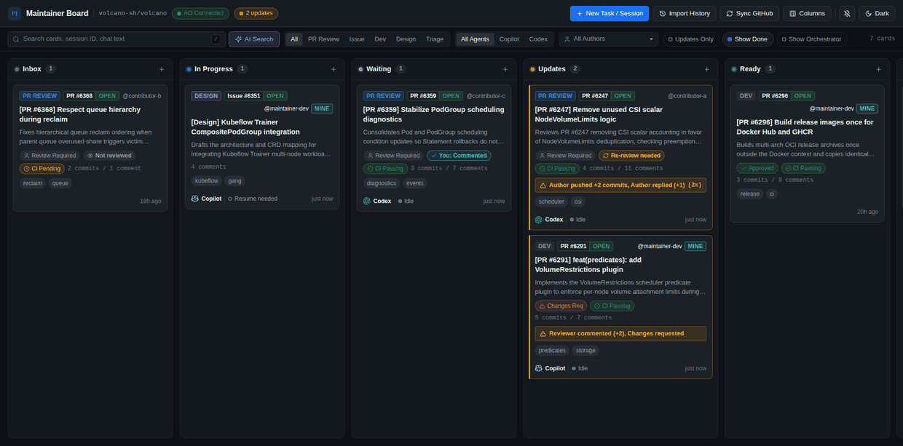

# Maintainer Board

A lightweight, single-binary Kanban workspace for open-source maintainers who juggle dozens of GitHub PR reviews, design proposals, and parallel AI coding sessions (**GitHub Copilot CLI** and **OpenAI Codex**) across repositories and machines.

Maintainer Board sits on top of the official upstream **Agent Orchestrator (`ao`)** daemon and the **`gh`** CLI. **No fork or modification of `ao` is required** -- it talks exclusively to a stock `ao` daemon over its local HTTP/SSE API.



---

## Agent Orchestrator (`ao`) vs. Maintainer Board

Maintainer Board is designed as a clean workflow layer over `ao`, keeping session execution in `ao` and maintainer triage in the board:

| Layer | Responsibilities |
| --- | --- |
| **Agent Orchestrator (`ao`)** (unmodified upstream daemon) | Owns agent process lifecycles (spawning, resuming, interrupting, killing, and deleting sessions), manages isolated git worktrees, streams structured agent conversations over SSE, exposes per-agent model & reasoning-effort catalogs, and scans local Copilot/Codex history stores for importable sessions. |
| **Maintainer Board** (this repo) | Adds a maintainer-oriented Kanban workflow (`Inbox`, `In Progress`, `Waiting`, `Updates`, `Ready`, `Done`), role-aware GitHub PR/Issue update detection (ignoring self & bot noise), stale-review / re-review tracking, author filtering, full-width expandable chat workspace, native-UUID + conversation + AI semantic search over local session history, fast task-focused AI card summaries, and single-URL browser access from any machine. |

```
Browser (Laptop / Desktop / Remote via SSH or Tailscale)
        |
        v
Maintainer Board (Go + SQLite + Embedded Web UI, :3012)
   |                 |                      |
   v                 v                      v
Upstream AO       gh CLI               Copilot / Codex CLI
(:3001 HTTP/SSE)  (PR/Issue/Reviews)   (Fast AI Summary & AI Search)
```

---

## Key Features

### 1. Maintainer Kanban with Role-Aware GitHub Tracking


- **Role-aware PR update detection**: Distinguishes PRs you review (`PR REVIEW`) from PRs you author (`MINE`):
  - **Reviewing others' PRs**: Surfaces actionable signals (`Author pushed +N commits`, `Author force-pushed`, `Author replied (+N)`, `Re-review needed`) while ignoring your own comments/reviews and bot activity.
  - **Tracking your own PRs (`MINE`)**: Ignores your own pushes/comments and highlights `Reviewer commented (+N)`, `Changes requested`, or `Approved`.
  - **Inline review comments & Prow support**: Polls both issue comments and inline PR review threads, and recognizes Prow `/lgtm` + `/approve` labels alongside GitHub review states.
- **Automatic column transitions**: Cards with unread GitHub updates move into **Updates** (with a cycle counter since your last review), approved PRs with passing CI move to **Ready**, and merged/closed items move to **Done**. One-click **Mark Caught Up** or **Reviewed -> Waiting** resets your review checkpoint.
- **Rich filtering & customization**: Filter by category (`PR Review`, `Issue`, `Dev`, `Design`, `Triage`), agent (`Copilot`, `Codex`), PR author, `Updates Only`, or instant full-text search across cards, session IDs, and transcripts. Columns can be added, renamed, reordered, or hidden.

### 2. Full-Width Expandable Agent Workspace & Model Picker


- **Split drawer or full-width workspace**: Inspect card metadata in the resizable side drawer, or click **Expand** (`F`) for a two-pane full-width chat view with a collapsible context rail. Clicking **Collapse** returns directly to the side drawer so you never lose your place on the board.
- **Live Copilot & Codex sessions**: Start new sessions or resume stopped ones directly from a card, stream responses live via AO SSE, interrupt running turns, or delete sessions cleanly from both the board and the AO server.
- **Per-session model & reasoning-effort controls**: Choose the agent, model, and reasoning effort when spawning a new session, or switch model/effort on any running session directly from the composer bar.
- **Fast task-focused AI summaries**: Click **Summarize with AI** to generate a concise summary of *what the PR or task is about* (configurable via `--summary-model` and `--summary-effort`).

### 3. Import History with UUID, Transcript & AI Semantic Search


- **Recover forgotten terminal sessions**: Scans AO's import candidates and enriches them from your local `~/.copilot/session-store.db` and `~/.codex/sessions/**/*.jsonl` stores.
- **Find by anything you remember**: Filter instantly by native session UUID, AO ID, title, folder, git branch, or words spoken inside the conversation -- or run **AI Search** for fuzzy semantic recall when you only remember what you asked the agent to do.

### 4. Dark & Light Themes, Zero Dependencies


- Single static Go binary with all HTML/CSS/JS/SVG assets embedded via `go:embed`.
- Local SQLite (WAL mode) database with automatic schema migrations.
- Full keyboard navigation (`/` search, `N` new task, `F` expand/collapse workspace, `Esc` step back).

---

## Prerequisites

1. **Go 1.24+** (to build from source).
2. **Upstream Agent Orchestrator (`ao`)** running locally (default `http://127.0.0.1:3001`), configured with your Copilot CLI and/or Codex harnesses.
3. **GitHub CLI (`gh`)** authenticated via `gh auth login` (for PR/Issue sync).
4. **Copilot CLI (`copilot`)** and/or **Codex CLI (`codex`)** on `PATH` (optional; used by **Summarize with AI** and **AI Search**).

---

## Quick Start

### 1. Start the upstream AO daemon

Make sure your upstream `ao` daemon is running on loopback (for example, `http://127.0.0.1:3001`) with at least one project registered:

```bash
# Example: verify your local AO daemon responds
curl -fsS http://127.0.0.1:3001/api/v1/projects
```

### 2. Build and run Maintainer Board

```bash
git clone https://github.com/JesseStutler/maintainer-board.git
cd maintainer-board

# Build and start with ./run.sh (rebuilds automatically when Go/web sources change)
MB_REPO=your-org/your-repo ./run.sh
```

Or build and run the binary directly:

```bash
go build -o ./maintainer-board ./cmd/maintainer-board

./maintainer-board   --addr 127.0.0.1:3012   --db ./data/board.db   --ao-url http://127.0.0.1:3001   --default-repo your-org/your-repo
```

Open `http://127.0.0.1:3012` in your browser.

---

## Remote & Multi-Device Access

Because `maintainer-board` proxies all AO session APIs and streams SSE through a single HTTP port (`127.0.0.1:3012` by default), you can keep your agents and git checkouts on one workstation/server and interact with every session from any laptop:

### Option A: SSH Local Port Forwarding (Recommended)

```bash
ssh -N -L 3012:127.0.0.1:3012 user@your-dev-machine
```

Then open `http://127.0.0.1:3012` locally. No ports are exposed on the network and loopback host checks pass automatically.

### Option B: Tailscale / LAN Binding

If you expose the board on a Tailscale IP or private hostname, pass `--allowed-hosts` so Host-header protection permits your address:

```bash
./maintainer-board   --addr 100.x.y.z:3012   --allowed-hosts "100.x.y.z:3012,devbox.tailnet.ts.net:3012"   --default-repo your-org/your-repo
```

> **Security note**: Maintainer Board has no built-in login layer because it controls live local agent sessions. Always keep it behind loopback + SSH forwarding, Tailscale ACLs, or an authenticated reverse proxy.

---

## CLI Flags

| Flag | Default | Description |
| --- | --- | --- |
| `--addr` | `127.0.0.1:3012` | HTTP listen address. |
| `--db` | `./data/board.db` | SQLite database path (parent directory created automatically). |
| `--ao-url` | `http://127.0.0.1:3001` | Base URL of the local upstream AO daemon. |
| `--ao-project` | *(first AO project)* | Default AO project ID used when spawning new sessions. |
| `--default-repo` | `volcano-sh/volcano` | Default `owner/repo` used for shorthand `#123` references. |
| `--sync-interval` | `120s` | Background GitHub sync interval (minimum `10s`). |
| `--ao-sync-interval` | `5s` | Background AO session sync interval (minimum `1s`). |
| `--gh-path` | `gh` | Path to the GitHub CLI binary. |
| `--gh-user` | *(auto from `gh api user`)* | GitHub login used to identify authored PRs (`MINE`) and personal reviews. |
| `--summary-model` | `gemini-3.8-flash` | Copilot CLI model for Summarize with AI and AI Search (empty uses CLI default). |
| `--summary-effort` | `low` | Reasoning effort passed alongside `--summary-model`. |
| `--copilot-path` | `copilot` | Path to the Copilot CLI binary for AI helpers. |
| `--codex-path` | `codex` | Path to the Codex CLI binary (fallback for AI helpers). |
| `--history-home` | `$HOME` | Home directory containing `.copilot` and `.codex` session stores for Import History enrichment. |
| `--ci-ignore-contexts` | `tide` | Comma-separated CI check/status contexts ignored in the CI rollup. |
| `--prow-approval-labels` | `true` | Treat the `lgtm` + `approved` Prow label pair as approved. |
| `--allowed-hosts` | `""` | Comma-separated extra `Host` headers allowed beyond loopback. |
| `--log-level` | `info` | Log verbosity (`debug`, `info`, `warn`, `error`). |

Environment overrides supported by `./run.sh`: `MB_ADDR`, `MB_DB`, `MB_AO_URL`, `MB_REPO`, `MB_SYNC_INTERVAL`.

---

## Project Layout

```
cmd/maintainer-board/   CLI entry point and server wiring
internal/
  ao/                   HTTP/SSE client for the upstream AO daemon
  db/                   SQLite schema, additive migrations, and CRUD store
  github/               gh CLI client, role-aware PR delta & review evaluator
  history/              Local ~/.copilot & ~/.codex session store indexer
  server/               HTTP API, SSE proxy, background sync loops
  summary/              AI card summary & semantic search runner
web/                    Embedded vanilla HTML/CSS/JS frontend & Node unit tests
scripts/                Headless Chromium UI verification suites & fake daemons
docs/media/             Screenshots and walkthrough GIF
```

---

## Development & Testing

```bash
# Go unit & race tests (includes static asset and zero-emoji checks)
go vet ./...
go test -race -count=1 ./...

# Frontend unit tests (Node.js 18+)
node --test web/tests/*.test.mjs
```

---

## License

MIT -- see [LICENSE](LICENSE).
