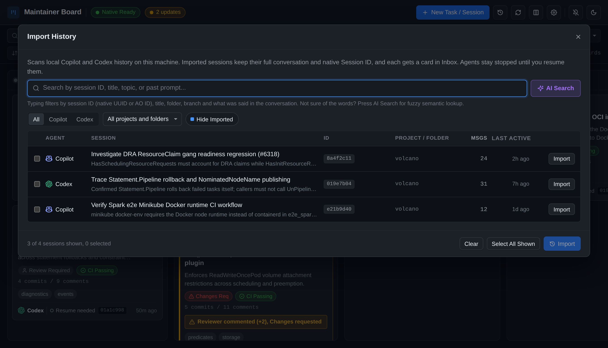

<div align="center">

# Maintainer Board

**A single-binary Kanban workspace for open-source maintainers using Codex CLI and GitHub Copilot CLI.**

Track PR reviews, issue threads, and parallel AI coding sessions in one place -- zero extra daemons, full native agent capabilities, and two-way terminal/web sync.


<br/>


</div>

---

## Quick Start

**Requirements:** Go 1.24+, `gh` CLI (logged in), and `codex` and/or `copilot` CLI on `PATH`.

```bash
git clone https://github.com/JesseStutler/maintainer-board.git
cd maintainer-board
MB_WORKSPACE=/path/to/your/repo MB_REPO=your-org/your-repo ./run.sh
```

Open **`http://127.0.0.1:3012`**.

Working on a remote dev machine? Forward one port from your laptop:

```bash
ssh -N -L 3012:127.0.0.1:3012 user@your-dev-machine
```

---

## What It Does

- **Never miss a re-review:** Polls your linked PRs and Issues via `gh`, ignores bot and self noise, and moves cards automatically across `Inbox -> Updates -> Waiting -> Ready -> Done` (with Prow `/lgtm` + `/approve` and multi-link `#pr #issue` support).
- **100% native Codex & Copilot sessions:** Talks directly to `codex app-server` and `copilot --acp` in your repo -- run tests, builds, and scripts with live expandable command output and per-session model/effort/permission controls.
- **Two-way terminal sync:** Every card shares the exact native Session ID (`codex resume <id>` / `copilot --resume <id>`). Turns run in your terminal appear in the board and vice versa.
- **Find any past session:** Import existing local `~/.codex` and `~/.copilot` sessions by UUID, transcript text, or fuzzy AI search.

---

## Architecture

<p align="center">
  
</p>

Maintainer Board is a single Go binary with an embedded UI and local SQLite database (`board.db`). Agent processes are spawned on demand only while you chat; idle cards consume zero background agent processes.

> Need worktree isolation via [Agent Orchestrator (`ao`)](https://github.com/ComposioHQ/agent-orchestrator)? Legacy AO mode remains available via `--runtime ao --ao-url http://127.0.0.1:3001`.

---

## Workspace & History Import

**Expanded Workspace** -- chat directly with native Codex or Copilot alongside synced PR/Issue context and live command output:


**Import Local History** -- pull existing terminal sessions straight from `~/.codex` and `~/.copilot` with keyword or AI semantic search:



---

## Configuration

Common startup options (also configurable in the top-bar **Settings** modal):

```bash
./maintainer-board \
  --workspace /path/to/your/repo \
  --default-repo your-org/your-repo \
  --approval-mode bypass-permissions \
  --addr 127.0.0.1:3012
```

> **Security:** Maintainer Board controls live local agent sessions and has no built-in login layer. Keep it on `127.0.0.1` with SSH forwarding, or use Tailscale with `--allowed-hosts`.

<details>
<summary>All CLI flags, environment variables, and development commands</summary>

### CLI Flags

| Flag | Default | Description |
| --- | --- | --- |
| `--addr` | `127.0.0.1:3012` | HTTP listen address. |
| `--db` | `./data/board.db` | SQLite database path. |
| `--runtime` | `native` | Agent runtime: `native` (default) or `ao` (legacy). |
| `--workspace` | *(current directory)* | Comma-separated local workspace paths. |
| `--default-repo` | `volcano-sh/volcano` | Default `owner/repo` for shorthand `#123` links. |
| `--sync-interval` | `120s` | GitHub background sync interval (min `10s`). |
| `--ao-sync-interval` | `5s` | Session sync interval (min `1s`). |
| `--gh-user` | *(auto from `gh`)* | GitHub login used to detect authored PRs and personal reviews. |
| `--approval-mode` | *(agent default)* | `default`, `accept-edits`, `auto`, or `bypass-permissions` (YOLO). |
| `--summary-model` | `gemini-3.8-flash` | Model for AI Summary, AI Title, and AI Search. |
| `--summary-effort` | `low` | Reasoning effort for AI helpers. |
| `--ci-ignore-contexts` | `tide` | Comma-separated CI contexts ignored in rollup. |
| `--prow-approval-labels` | `true` | Treat `lgtm` + `approved` labels as approved. |
| `--allowed-hosts` | `""` | Extra allowed `Host` headers (for Tailscale/LAN). |
| `--gh-path` / `--codex-path` / `--copilot-path` | `gh` / `codex` / `copilot` | Custom CLI binary paths. |
| `--history-home` | `$HOME` | Home directory containing `.codex` and `.copilot`. |
| `--ao-url` / `--ao-project` | `http://127.0.0.1:3001` | Optional AO daemon settings (`--runtime ao`). |
| `--log-level` | `info` | `debug`, `info`, `warn`, or `error`. |

`./run.sh` environment overrides: `MB_ADDR`, `MB_DB`, `MB_RUNTIME`, `MB_WORKSPACE`, `MB_REPO`, `MB_SYNC_INTERVAL`, `MB_AO_URL`.

### Development & Tests

```bash
go vet ./...
go test -race -count=1 ./...
node --test web/tests/*.test.mjs
```

</details>

## License

[MIT](LICENSE)
